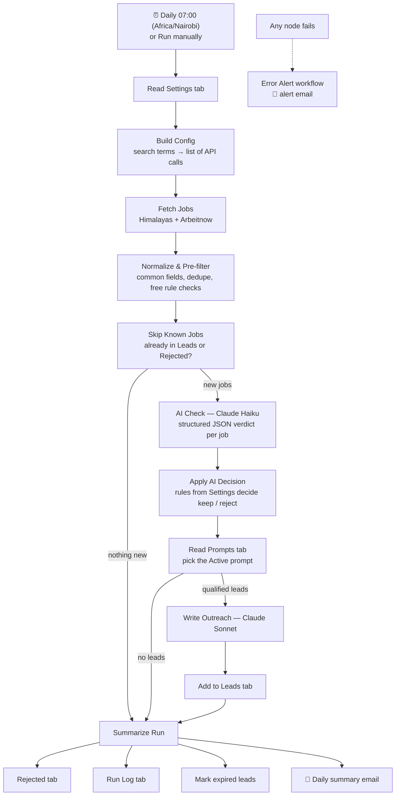

# Task 1 — RAY Lead Engine

An n8n workflow built to run every morning. It finds companies hiring an Executive or Administrative Assistant, checks that each job is remote, English-speaking, relevant and posted by a real end client, and writes a personalized outreach message for each one with Claude. The results go to a Google Sheet that a sales rep can work from directly.

> **Why it's built as a lead engine.** A company hiring an EA has a need RAY already sells. So the outreach message offers that company RAY's assistant service. It is not a job application. Treating hiring signals as sales leads means RAY could run this in production, not only as an exercise.

**Results from real runs (27 Oct 2026):** 524 jobs fetched → 97 passed the rule-based filter → 74 reviewed by Claude → **16 qualified leads**, each with a ready-to-send message. 91 rejections are logged with reasons.

| | |
|---|---|
| Google Sheet (live output) | _link added before submission_ |
| n8n workflow export | [`workflow/RAY_Lead_Engine.json`](workflow/RAY_Lead_Engine.json) + [`workflow/RAY_Lead_Engine_Error_Alert.json`](workflow/RAY_Lead_Engine_Error_Alert.json) |
| Sample output | [`sample-output/`](sample-output/): `leads.csv`, `leads.json`, `rejected.csv`, `run_log.csv` |
| Empty Sheet template | [`sheet-template/RAY_Lead_Engine_Template.xlsx`](sheet-template/RAY_Lead_Engine_Template.xlsx) |

---

## Contents
1. [How it works](#1-how-it-works)
2. [Validation: the four checks](#2-validation-the-four-checks)
3. [LLM integration](#3-llm-integration)
4. [Job sources and compliance](#4-job-sources-and-compliance)
5. [The Google Sheet](#5-the-google-sheet)
6. [User guide for the sales rep](#6-user-guide-for-the-sales-rep)
7. [Setup](#7-setup)
8. [Reliability](#8-reliability)
9. [Results and accuracy](#9-results-and-accuracy)
10. [Troubleshooting](#10-troubleshooting)
11. [Limitations and next steps](#11-limitations-and-next-steps)
12. [How this was built](#12-how-this-was-built)

---

## 1. How it works

| Stage | What happens | Why |
|---|---|---|
| **A. Fetch & pre-filter** | Reads `Settings`, calls the job APIs, maps both sources to one format (title, company, location, description, URL, languages), removes duplicates, then runs free rule checks: age, expiry, title words, excluded words, agency blocklist, remote flag, non-English text. | Rule checks cost nothing. Most jobs that are clearly irrelevant never reach the paid AI step. |
| **B. AI check** | Skips any job already in `Leads` or `Rejected`. Claude Haiku judges each remaining job and returns a fixed JSON structure. The workflow's own rules then decide. | The AI judges, and code applies the rules, so the decisions are predictable and controlled from Settings. |
| **C. Outreach** | Claude Sonnet writes one message per qualified lead, using the Active prompt from the `Prompts` tab. | The tone can be changed or A/B tested without touching the workflow. |
| **D. Wrap-up** | Every path ends at one node, which writes rejections and the run log, marks expired leads, and sends the daily summary. | One run log entry even on days with no new jobs, so it's always clear whether the workflow ran. |

---

## 2. Validation: the four checks

A job becomes a lead only if it passes **all four**:

| Check | Rule-based (free) | Claude (judgment) |
|---|---|---|
| **Remote** | Board's remote flag (Arbeitnow); Himalayas lists only remote jobs | `is_remote`: hybrid or partly on-site counts as not remote |
| **English-speaking** | Detects German-language descriptions | `english_ok`, plus `other_languages_required` (only required languages, not "nice to have") |
| **Relevant EA/Admin role** | Title must contain an assistant-type word; titles with an excluded word (e.g. "paralegal", "medical") are dropped | `relevant`: is the core of the role supporting a founder or executive? This catches "Marketing Assistant" or "Legal Assistant" titles. |
| **Real end client, not an agency** *(added)* | Agency blocklist in `Settings` | `is_agency_or_recruiter` plus `agency_evidence`, including hidden signs: the boss described in the third person, a different company named as the employer, a hiring process that ends with a "client interview" |

The fourth check is our own addition. Staffing firms and VA agencies post many EA jobs, but they sell the same service as RAY. They're either competitors or middlemen who hide the real client. Pitching them wastes the rep's time and hands RAY's pitch to a rival.

Claude also returns a **fit score from 0 to 100**, and jobs below **Minimum lead quality** (default 60) are rejected. Leads are capped at **Max new leads per day**, best scores first. Jobs above the cap aren't rejected. They wait and are reconsidered on the next run.

Every rejection is written to the `Rejected` tab with the check that failed and the reason. Two exceptions, left out on purpose because there would be hundreds a day and they'd bury the useful ones: titles that aren't assistant roles, and jobs that are too old.

---

## 3. LLM integration

| | AI Check | Write Outreach |
|---|---|---|
| Model (set in `Settings`) | `claude-haiku-5-5`: fast and low-cost | `claude-sonnet-5-5`: better writing |
| Output | JSON forced into a fixed structure: `is_remote`, `english_ok`, `other_languages_required`, `relevant`, `is_agency_or_recruiter`, `agency_evidence`, `hiring_company`, `fit_score`, `hooks`, `reason` | JSON: `subject` and `body` |

**Design choices**
- **Structured outputs.** Both calls use a JSON schema, so the reply always has the expected fields and the workflow never has to guess what the text means.
- **Facts only from the posting.** The checker pulls 2–3 **hooks**: concrete details such as who the assistant supports, specific duties, or time zones. The writer may use only those hooks and the "About RAY" text from Settings. Fixed rules forbid invented clients, numbers or claims, as well as `[Name]` placeholders and markdown.
- **Fixed safety rules vs. editable prompt.** The rules above sit in the system prompt, inside the workflow. The tone and structure sit in the `Prompts` tab. Editing a prompt changes the style, but it can't remove a safety rule.
- **Prompt-injection guard.** Job text is wrapped in `<job_posting>` tags, and both models are told it's untrusted data and to ignore any instructions inside it.
- **Prompt versioning.** The `Prompts` tab holds several versions (v1 Consultative, v2 Short & direct, v3 Founder-to-founder). Exactly one is marked **Active**. Each lead records the **Prompt Version** that wrote it, so reply rates can be compared by version.

**A real message from the sample output** (Smartland, fit score 85):

> **Subject:** Support for your CEO's executive assistant role
>
> Hi Smartland team,
>
> Saw your opening for an Executive Assistant to the CEO. Keeping track of who owes what and what's due when, across a company managing 1,400+ rental homes and apartments, is a big job, especially with a CEO who moves fast and decides faster. …

---

## 4. Job sources and compliance

No LinkedIn and no scraping. Only official public APIs, used within their terms. Each source was test-called before it was chosen.

| Source | Decision | Reason |
|---|---|---|
| **[Himalayas](https://himalayas.app)** | ✅ Primary | Free public API with full descriptions (about 4k chars) and 1,200+ results for "executive assistant". Its terms allow commercial use, with conditions that we follow: job links are the original `applicationLink`, unchanged; Himalayas is credited visibly in the Sheet and in every summary email; jobs aren't passed to other job boards; expired jobs are removed (see below). |
| **[Arbeitnow](https://www.arbeitnow.com)** | ✅ Secondary (can be switched off in Settings) | Free API, and the terms ask only for a link back. It has few EA roles and many German postings, so in practice it mostly shows the filters at work. |
| Adzuna | ❌ Not used | Descriptions are cut off at 500 chars, results are dominated by recruiters and on-site roles, and it's paid after a small trial. A possible paid source later. |
| Remotive | ❌ Not used | The free feed is capped at 10 jobs, and its terms say the API exists for re-sharing jobs, which doesn't fit lead generation. |
| Jobicy | ❌ Not used | Too few EA roles. |
| The Muse | ❌ Not used | Blocks API requests (HTTP 403). |

**Expiry handling (a Himalayas condition).** Each run finds leads whose job has expired and that are still marked `New`. It sets their Status to `Expired` and clears the copied job description. Leads the rep has already worked on are left alone.

**Public repo.** The sample output shortens job descriptions to about 300 characters, and every job links back to its original posting, so the repo doesn't re-publish the jobs.

> **Adding a new job board** needs a new fetch branch in the workflow. The `Settings` switches only turn on or off sources that already have one.

---

## 5. The Google Sheet

| Tab | Purpose |
|---|---|
| **Start Here** | A one-page guide for the rep. |
| **Leads** | The work queue. The six required columns come first, in this order: **Job Posting URL, Job Title, Company Name, Location, Job Description, LLM-Generated Outreach Message**. After them come the rep's working columns: Fit Score, Why it matched, Status (New / Contacted / Replied / Won / Lost), Date Found, Follow-up Date, Language Requirements, Expires, Prompt Version, Source, Notes. |
| **Settings** | All configuration, in plain language. The rep edits only the "Your choice" column. |
| **Prompts** | Message styles. Set exactly one row to Active = Yes. |
| **Rejected** | Every rejected job with the failed check and the reason, so the filter can be checked. |
| **Run Log** | One row per run: jobs fetched, after pre-filter, classified, new leads, rejected, duplicates skipped, errors. |

**What you can change in `Settings`**

| Group | Settings |
|---|---|
| What to search | Job titles to search for · Himalayas on/off · Arbeitnow on/off · Jobs to check per run · Only jobs posted in the last N days · Max new leads per day |
| What to skip | Title words to skip · Agency blocklist · Allow roles needing a second language? · Minimum lead quality (0–100) |
| Your messages | Your name · Your job title · About RAY (the only facts the AI may use) · Closing question · Booking link · Max message length |
| Daily email | Send me a daily summary? · Send it to · How many top leads to include · Send error alerts to |
| Advanced | AI model for checking jobs · AI model for writing messages |

---

## 6. User guide for the sales rep

**Every morning (about 15 minutes)**
1. Open the daily summary email ("RAY leads: N new"), or open `Leads` and filter **Status = New**.
2. Work from the highest **Fit Score** down. Read **Why it matched**, then the message.
3. Edit the message if needed, find the founder's or hiring manager's contact, and **send it from your own inbox**.
4. Set **Status = Contacted** and choose a **Follow-up Date**.
5. As replies come in, update Status to **Replied / Won / Lost** and add **Notes**.

**When something needs adjusting**

| Situation | What to do |
|---|---|
| A lead turns out to be an agency | Set Status = Lost and add the company name to the agency blocklist in `Settings`. It will never come back. |
| Too few leads | Increase **Jobs to check per run**, or lower **Minimum lead quality** a little. |
| Leads are too weak | Raise **Minimum lead quality**, or add words to **Title words to skip**. |
| A good job seems to be missing | Look for it in `Rejected`. The reason shows which setting to change. |
| You want a different tone | In `Prompts`, set another row to Active = Yes, or add your own row. Then compare replies by **Prompt Version**. |

The workflow **drafts and never sends**. Cold outreach is reviewed by a person before it goes out, which protects RAY's sender reputation and catches anything that reads wrong.

---

## 7. Setup

**You need:** an n8n instance (Cloud or self-hosted), an Anthropic API key, and a Google account for Sheets and Gmail.

1. **Create the Sheet.** Upload [`sheet-template/RAY_Lead_Engine_Template.xlsx`](sheet-template/RAY_Lead_Engine_Template.xlsx) to Google Drive and open it with Google Sheets (File → Save as Google Sheets). Copy its ID, the long string in the URL between `/d/` and `/edit`.
2. **Point the workflows at your Sheet.** Open both JSON files in a text editor, find and replace `1qs8KZSVPqFrMvPLQ9kXMcUAyStUmYLxjEu0-Vt5EMPk` with your Sheet ID, and save.
3. **Import the error workflow first.** In n8n, go to Workflows → Import from File → `RAY_Lead_Engine_Error_Alert.json`. Then import `RAY_Lead_Engine.json` the same way.
4. **Add credentials** (n8n → Credentials → Add):
   - **Google Sheets OAuth2**, signed in with the Google account that owns the Sheet
   - **Anthropic API**, with your API key
   - **Gmail OAuth2**, for the summary and alert emails

   Open each node that shows a warning and select the matching credential. No credentials are stored in the JSON files.
5. **Link the error alert.** In the main workflow, open **⋯ → Settings → Error Workflow** and choose "RAY Lead Engine: Error Alert".
6. **Fill in `Settings`.** At minimum: your name, "Send it to", and "Send error alerts to".
7. **Test.** Click **Run manually**, then check `Leads`, `Rejected`, `Run Log` and your inbox.
8. **Go live.** Check that **⋯ → Settings → Timezone** is set to your timezone (e.g. Africa/Nairobi), then switch the workflow to **Active**. It then runs every day at 07:00.

> **Demo instance note:** in the case-study instance the schedule is configured but left **inactive** to save API credits. The runs documented in section 9 were started manually. Going live takes one switch.

---

## 8. Reliability

| Concern | How it's handled |
|---|---|
| **Re-runs and duplicates** | Before calling Claude, the workflow drops any job already in `Leads` or `Rejected`, matched by Job Posting URL. Running it twice creates no duplicate rows and no double AI cost. Rejections are upserted by URL. |
| **Partial failures** | Fetch and Claude calls retry 3 times, then continue. A failed AI check is logged in `Rejected` as "AI check failed". A failed message still saves the lead, with a note asking the rep to write that one by hand. The run is marked **Warnings** in the Run Log. |
| **Hard failures** | The **Error Alert** workflow emails the address in `Settings` with the error, the node where it happened, and a link to the failed run. If the Sheet itself can't be read, it uses a fallback address. |
| **Rate limits and cost** | Requests are sent in batches: job APIs one per second, Claude 2–3 at a time. The free rule filter runs first. A cheap model classifies and a stronger one writes. There's a daily cap on new leads. |
| **Visibility** | One Run Log row for every run, including days with nothing new. Every rejection is logged with its reason. |
| **Secrets** | Kept only in n8n credentials. The JSON exports contain credential names, never keys. |

---

## 9. Results and accuracy

From the two runs on 27 Oct 2026 (see [`sample-output/run_log.csv`](sample-output/run_log.csv)):

| Run | Fetched | Passed pre-filter | Reviewed by AI | Duplicates skipped | New leads | Rejected |
|---|---|---|---|---|---|---|
| 1 (100 jobs per run) | 355 | 26 | 26 | 0 | 3 | 29 |
| 2 (300 jobs per run) | 524 | 97 | 74 | 23 | 16 | 70 |

In run 2, 23 jobs were skipped because run 1 had already handled them, which shows the de-duplication working.

**Accuracy was checked by hand.** Claude caught agencies that weren't on any list, such as Paired, Hire Overseas, FreedUp, Virco Talent and Remote Craft, often quoting the giveaway phrase. Each lead's hiring company was then checked manually. **3 of the 19 leads across both runs (about 84% precision) turned out to be agencies** that hide it well (OptiNizers, Easy Outsource, D2B). They were removed from `Leads` and added to the blocklist, which is exactly the process the rep follows. The hidden-agency instructions had already been tightened before these runs, after an earlier test run let similar agencies through.

The final list has **16 real end clients**, including Panorama Education, JumpCloud, Nominal, Women Donors Network, DISCO and Smartland.

---

## 10. Troubleshooting

| Problem | Cause and fix |
|---|---|
| Google Sheets: *"Forbidden – perhaps check your credentials? The caller does not have permission"* | The Google credential is signed in with a different account from the one that owns the Sheet. Pick the right credential, or share the Sheet with that account as Editor. |
| The schedule runs at the wrong hour after re-importing | The workflow was copied from the canvas instead of downloaded. A canvas copy drops the workflow's name and timezone. Always use **⋯ → Download**, or set Settings → Timezone again. |
| No new leads today | Check `Run Log`. "Duplicates Skipped" equal to "After Pre-filter" means nothing new was posted. Otherwise, check `Rejected` for the reasons, then adjust **Jobs to check per run** or **Minimum lead quality**. |
| An agency appears in `Leads` | Add it to the agency blocklist in `Settings` and set its Status to Lost. |
| A lead's message is empty, with a note | The writing call failed after retries. Write that message by hand, or delete the row and run again. |
| Claude errors (401 / 429) | 401: the Anthropic key is wrong or has no credit. 429: rate limit. Lower **Jobs to check per run** or **Max new leads per day**. |
| No summary email | Check "Send me a daily summary?" = Yes and "Send it to" in `Settings`, plus the Gmail credential. |

---

## 11. Limitations and next steps

- **Contact details.** Job boards don't publish the hiring manager's email, so the rep looks it up. Next step: a contact-finding API (e.g. Hunter or Apollo) that adds the founder's name and email.
- **Hidden agencies.** About 1 in 6 leads needed a manual blocklist entry. Next step: a free rule that flags companies with many open roles across unrelated fields. Easy Outsource had 83 open jobs, for example.
- **Full-time only.** Himalayas supports `employment_type=Full Time`, which matches RAY's 40-hours-a-week offer. It could become a Settings switch. Claude already scores part-time roles low.
- **More sources.** Adzuna (paid) or other compliant APIs, each added as a new fetch branch.
- **CRM sync.** Push qualified leads to HubSpot or Pipedrive instead of a Sheet once volume grows.
- **Measuring results.** Track reply rate by Prompt Version, and keep a small labelled set of postings to re-test the classifier whenever the prompt changes.

---

## 12. How this was built

Built in n8n Cloud with **Claude Code as a pair-programmer**. My part: the product decisions (lead-gen framing, the competitor filter, source selection and compliance, human review before sending), running and checking every stage in n8n against live data, finding the agencies the first version missed, and directing the prompt and rule changes that fixed them.
